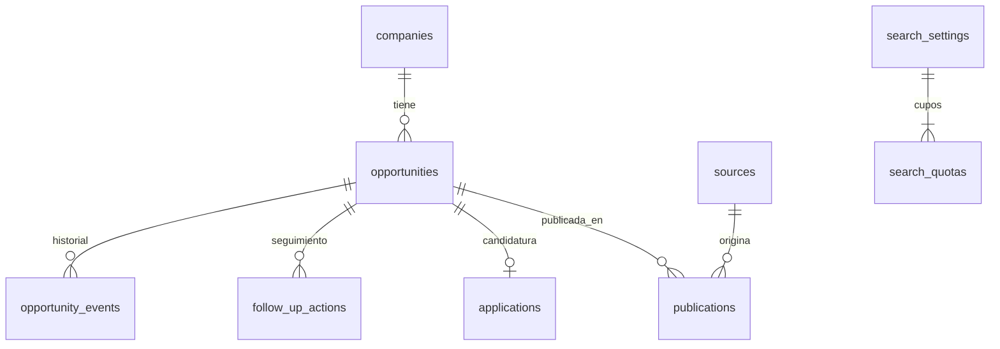

# Modelo de dominio y datos

Revisión: 11 de noviembre de 2026. Este documento sustituye el modelo inicial de `offers.status`. Distingue el núcleo implementado en la migración 002 de los módulos aún por desarrollar. Normalizar no consiste en repartir el mismo objeto JSON entre varias tablas: cada entidad tiene identidad, relaciones y reglas propias.

## 1. Qué representa cada entidad

| Entidad | Identidad y cardinalidad | Regla |
| --- | --- | --- |
| Empresa | `companies.id`; una empresa tiene muchos procesos | El nombre no es único. Seleccionar una empresa existente reutiliza su ID; escribir otra crea otra entidad. Cambiar de empresa en un proceso no renombra las demás ofertas. |
| Proceso / convocatoria | `opportunities.id`; pertenece a una empresa | Es la unidad de candidatura, historial y deduplicación. Empresa+título no es una clave: puede haber dos convocatorias iguales. |
| Fuente | `sources.id`, `namespace` único | Identifica la procedencia. Un ATS puede necesitar un namespace por tenant, no solo por dominio. |
| Publicación | `publications.id`; muchas por proceso | Un anuncio en LinkedIn y otro en la web corporativa pueden representar el mismo proceso. URL única; ID externo único dentro de su fuente cuando se conoce. Solo una referencia principal. |
| Candidatura | `applications.id`; cero o una por proceso en este producto personal | Su existencia acredita un antecedente que bloquea nuevas búsquedas. Cambiar el estado no elimina ese antecedente. Fecha de inscripción desconocida se conserva como NULL. |
| Acción de seguimiento | `follow_up_actions.id`; muchas por proceso | Cada llamada, revisión o recordatorio tiene fecha y estado propios. Completar una no elimina las demás. No envía mensajes ni crea recordatorios externos. |
| Evento | `opportunity_events.id`; muchos por proceso | Actor, fecha, tipo, motivo y detalle de la operación. El JSON es una instantánea de auditoría; no sustituye relaciones operativas. |
| Configuración de búsqueda | `search_settings.id` | Columnas tipadas, restricciones y revisión de concurrencia. |
| Cupo | `search_quotas(settings_id, zone)` | Relación separada, no un número incrustado en una configuración arbitraria. Por ahora las zonas disponibles son España/resto de Europa. |

La API conserva `/api/offers` como nombre del recurso para el panel, pero internamente devuelve procesos mediante la vista `offer_summary`. No existe un segundo almacén de ofertas editable. `legacy_*` son archivos de la migración; no se usan para nuevas escrituras.

## 2. Estados independientes

### Disponibilidad del proceso

`desconocida`, `abierta`, `pausada`, `cerrada`, `cubierta`, `cancelada`.

Es información sobre la convocatoria. Una URL inaccesible no prueba cierre. Reabrir exige evidencia o corrección manual con motivo. No reinicia publicación, antigüedad ni candidatura. Una publicación puede cerrarse mientras otra referencia del mismo proceso continúa abierta: cuando se implementen observaciones por fuente, la disponibilidad agregada requerirá reconciliar evidencia, no copiar el último HTTP.

### Revisión personal

`nueva`, `en_revision`, `guardada`, `descartada`.

Guardar no acredita candidatura. Descartar es una decisión del usuario sobre ese proceso. Se permite recuperarlo con motivo, siempre manteniendo cualquier bloqueo por candidatura o cierre. Archivar una pantalla será una preferencia de visualización independiente, nunca una forma de borrar historial.

### Candidatura

Ausencia de fila = `sin_candidatura` en la API. Con fila: `enviada`, `en_revision`, `prueba`, `entrevista`, `oferta`, `aceptada`, `incorporada`, `rechazada_empresa`, `oferta_rechazada`, `retirada`, `sin_respuesta`. `rechazada_sin_detalle` conserva importaciones antiguas ambiguas sin atribuir el rechazo a nadie.

- Se admite registrar directamente una entrevista o un rechazo históricos sin inventar etapas anteriores.
- El recorrido habitual es enviada → revisión → prueba/entrevista → oferta → aceptada → incorporada. Pruebas y entrevistas pueden repetirse; sus rondas serán entidades separadas.
- Una empresa puede reactivar una candidatura rechazada; se actualiza la etapa con motivo y se conservan los eventos. No se crea otra inscripción para el mismo proceso.
- Rechazo de la empresa, rechazo de una propuesta por el candidato y retirada son hechos distintos.
- Sin respuesta no significa rechazo; tampoco habilita la búsqueda de la misma convocatoria.
- La app registra acciones que el usuario ya realizó fuera de ella. Seleccionar «enviada» nunca envía una solicitud.
- No se permite volver a `sin_candidatura` desde un registro existente mediante el editor ordinario. Un error de importación requerirá una operación explícita de corrección con motivo, actor y revalidación del historial; esa operación está pendiente.
- Cualquier cambio de estas dimensiones en un proceso existente exige motivo y revisión vigente. No se obliga a seguir un embudo secuencial que impediría cargar el historial real.

### Acciones de seguimiento

`pendiente` → `completada` o `cancelada`; ambas pueden volver a `pendiente`. La fecha prevista es opcional. Una acción vencida se calcula comparando la fecha local de Madrid con hoy; no es otro estado almacenado. Completar registra fecha real. Reabrir limpia la fecha de finalización actual y conserva el evento anterior.

### Evaluación profesional (pendiente)

A/B/C, encaje y computabilidad son dimensiones de una evaluación versionada; no son estados de candidatura. Una persona puede inscribirse en una B o en una C. Eso no debe convertir retrospectivamente la evaluación en A. Una C por antigüedad no significa que la empresa haya rechazado a nadie.

## 3. Política de búsqueda e historial

Bloqueo actual derivado por proceso:

1. Existe candidatura, cualquiera que sea su etapa; o
2. revisión personal descartada; o
3. disponibilidad pausada, cerrada, cubierta o cancelada.

Un proceso conocido sin bloqueo devuelve `already_known: true`: se reutiliza el ID, no se da de alta otra fila. Un enlace alternativo registrado resuelve al mismo proceso y aplica el mismo bloqueo. Empresa+título solo produce `needs_review`, incluso si el proceso anterior no está bloqueado: dos convocatorias iguales no deben fusionarse ni ignorarse automáticamente.

En el futuro, el bloqueo distinguirá ámbito (empresa/proceso/publicación), motivo, evidencia, caducidad y origen. Las exclusiones de empresas como CNAC/Hubmud estarán en reglas explícitas, no escondidas en el prompt. Una desestimación histórica inequívoca sin constancia de candidatura requiere un bloqueo de proceso, no inventar una candidatura.

No habrá una opción general «ignorar historial». Una investigación manual de una referencia bloqueada podrá inspeccionar su registro; una nueva convocatoria exige identidad nueva y relación con la anterior. Un reintento técnico jamás anula estos bloqueos.

## 4. Casos de uso y consecuencias

| Caso | Comportamiento y segunda consecuencia |
| --- | --- |
| Misma oferta en dos portales | Dos publicaciones, un proceso, una candidatura. Si se abren ambas fichas, cuentan dos aperturas del límite de ejecución. |
| URL principal deja de funcionar | Se conserva como referencia; añadir otra no pierde el enlace que permite reconocer historial. Falta implementar selección de nueva principal. |
| URL de ATS cambia de dominio | Buscar ID público y destino, registrar alias tras verificar. Hasta entonces revisión de identidad. |
| ATS reutiliza un ID | La URL/ID no se reasigna automáticamente. Registrar conflicto y resolver convocatoria/versionado de referencia antes de fusionar. |
| Empresa republica anuncio | No reiniciar antigüedad ni candidatura. Determinar si es republicación o convocatoria distinta. |
| Mismo título, nueva convocatoria | Nuevo proceso solo si hay evidencia; vincularlo al anterior. No bloquear automáticamente toda la empresa. |
| Empresa homónima | Mantener IDs distintos; dominio y alias ayudan a resolver identidad, no fusionar por nombre. |
| Empresa cambia de marca | Alias de empresa; no crear candidaturas nuevas. Renombrar globalmente será una acción explícita. |
| Consultora publica para un cliente | Separar empleador, publicador y cliente con roles. No atribuir al publicador la contratación por defecto. |
| Guardar una oferta | Solo revisión personal. Sigue sin candidatura. |
| Pulsar «Solicitar» fuera de la app | No confirma envío. Registrar pendiente de comprobación, no fabricar inscripción. |
| Inscripción registrada dos veces | Misma candidatura, evento adicional. Evitar duplicar a través de alias y claves idempotentes de importación. |
| Rechazo tras entrevista | Actualizar candidatura, conservar entrevista y acciones. No cancelar recordatorios automáticamente sin decisión visible. |
| Rechazo antes de inscribirse | Descarte/bloqueo del proceso; no candidatura de rechazo inventada. |
| Reapertura después del rechazo | Disponibilidad abierta; candidatura histórica sigue bloqueando rastreo y nueva inscripción automática. |
| Retirada voluntaria | Etapa retirada, motivo; conserva antecedente. |
| Sin respuesta durante semanas | Mantener sin respuesta o acción vencida; no inferir rechazo ni cierre. |
| Oferta económica recibida | Etapa oferta, sin confundirla con el anuncio. Propuestas y negociaciones se modelarán aparte. |
| Aceptación que luego se cancela | Evento y nueva etapa con motivo; no borrar aceptación ni asumir incorporación. |
| Varias entrevistas/pruebas | Varias etapas/actividades fechadas, con estado propio; el campo de etapa actual es un resumen. |
| Dos seguimientos el mismo día | Dos acciones independientes. Completar una no elimina otra. |
| Cierre detectado con seguimiento pendiente | Advertir incompatibilidad; conservar acción hasta que el usuario complete/cancele. |
| Fusión de duplicados | Elegir superviviente, trasladar referencias/acciones/eventos, conservar redirección del ID y bloqueo más restrictivo; conflicto de candidaturas exige revisión. Pendiente. |
| Fusión equivocada | Debe poder deshacerse con registro de procedencia. No borrar IDs durante la fusión. Pendiente. |
| Cambio de perfil o criterio | Nueva versión de evaluación, invalidar solo dependencias afectadas. Conservar resultado anterior y motivo. |
| Fuentes contradictorias | Guardar observaciones por fuente y fecha. No sobrescribir silenciosamente contrato/fecha/cierre. |
| Multipaís o remoto europeo genérico | Varias ubicaciones permitidas; país del cupo puede seguir sin resolver. No usar una lista de países como país atribuido. |
| Oferta a tiempo completo | Jornada no prueba relación contractual indefinida. Modelar ambas por separado. |
| Dos pestañas editan el mismo proceso | La segunda recibe 409. Acciones y publicaciones incrementan versión del padre para invalidar formularios antiguos. |
| n8n repite una petición tras timeout | Futuro comando con clave idempotente y resultado persistido. No considerar que un timeout implica que no se guardó. |
| Cambia historial durante ejecución | Invalidar cruces afectados y revalidar antes del cierre; snapshots de configuración no congelan bloqueos nuevos. |
| Servicio cae después de abrir ficha | Apertura reservada de forma transaccional antes del acceso, con estados de resultado. El reintento no duplica cupo. |
| Cuota modelo agotada | Tarea bloqueada/reintentable, sin dato inventado y sin consumo duplicado por reanudación. |
| Fecha desconocida | NULL/pendiente con procedencia. No usar la fecha de importación como publicación. |
| Corrección manual errónea | Evento auditable y revisión; deshacer mediante otra corrección, no eliminando el historial. |
| Borrar del panel | Archivado visual; no borrar historial que evita reaplicaciones. Borrado real/exportación requerirán política explícita. |

## 5. Modelo de los siguientes módulos

No se crearán tablas vacías de estos módulos hasta implementar sus operaciones, restricciones y pruebas. Las siguientes relaciones guían las migraciones; no se almacenarán estos datos operativos como listas dentro de `settings`.

| Módulo | Relaciones previstas y restricciones |
| --- | --- |
| Identidad | `company_aliases(company_id, alias, evidence_id)`, `opportunity_relations(from_id,to_id,type)` y `identity_reviews`; no ciclos en redirecciones de fusión, alias de portal/ID acotado al tenant. |
| Publicaciones | `publication_observations(publication_id, observed_at, access_state, document_id)`; fecha de publicación/rango con tipo de fecha y evidencia. Cierre del anuncio separado del proceso. |
| Documentos y evidencia | `documents(publication_id, content_hash, fetched_at, text)`, `evidence(document_id, quote, offsets)`; versiones inmutables, evidencia siempre ligada a la versión exacta del texto. |
| Localización | `countries`, `locations`, `opportunity_locations(opportunity_id,location_id,role)` y elegibilidad remota por país; rol distingue adscripción del puesto de país permitido. |
| Condiciones | `employment_terms(opportunity_id,version,relationship,duration,working_time,evidence_id)`; salario por rango, moneda, periodo y bruto/neto sin convertir monedas sin referencia. |
| Requisitos | `requirements(opportunity_id,kind,necessity,alternative_group,evidence_id)` y tablas tipadas para años/idiomas/tecnologías/titulaciones; un grupo OR no se interpreta como AND. Méritos separados de obligaciones. |
| Perfil | `candidate_profiles`, `profile_versions`, `skills`, `profile_skills`, `experiences`, `qualifications`, `languages`; formación, prácticas y proyectos diferenciados; no atribuir años de empresa. Producto inicialmente de un solo usuario, sin tablas de organizaciones o permisos ficticios. |
| Reglas | `search_profiles`, `search_profile_versions`, `enabled_sources`, `queries`, `quotas`, `exclusion_rules`; columnas tipadas para reglas conocidas, JSON solo para payloads de proveedor y snapshots inmutables versionados. |
| Evaluaciones | `evaluations(opportunity_id,profile_version,rule_version,cutoff_at,class,fit)`, `evaluation_findings(rule_id,evidence_id,outcome)`, `pending_questions(owner,state,resolution)`; una evaluación nueva no sobrescribe la anterior. Computabilidad deriva de fundamentos y cupos. |
| Bloqueos | `search_blocks(scope,subject_id,reason,evidence_id,valid_until)` y eventos de activación/corrección; nunca confundir un rechazo de empresa con una preferencia por empresa. |
| Candidaturas | `application_stages`, `interviews`, `assessments`, `employment_proposals`, `contacts`, `application_contacts`; propuesta salarial distinta del proceso ofertado, actividades con fechas y zonas horarias. |
| Ejecuciones | `runs(config_version,cutoff_at,status,stop_reason)`, `leads(run_id,source_id,url)`, `run_openings(run_id,publication_id)` único, `tasks(run_id,kind,input_version,status,attempt)`; reservas y límites bajo bloqueo de fila. |
| Reintentos | `task_attempts(task_id,attempt,state,error,started_at,ended_at)` y comandos con idempotency key único. Estados queued/running/succeeded/retry_wait/failed/cancelled; lease para recuperar workers caídos sin ejecutar dos veces. |
| Historial | Revisión monotónica y cruces por proceso/claves/revisión. Si cambia mientras se audita, invalidar finalistas afectadas. La marca `history_ready` actual solo confirma carga inicial, no implementa esto. |
| Importaciones | `imports`, `import_rows`, mapeo externo→interno, hash/idempotencia, coincidencias por revisar; ejecutar en lotes con errores por fila y sin asumir que una empresa coincide por nombre. |

## 6. Invariantes y migración

- FKs sin cascadas destructivas; índices en las relaciones usadas para consultar historial.
- No eliminar publicaciones para cambiar un enlace; añadir referencia preserva identidad conocida.
- No son únicos empresa+título, nombre de empresa, ni fecha de acción.
- Cambios del proceso, candidatura y evento en una transacción; concurrencia optimista más bloqueo del proceso.
- Un cambio de padre, publicación o acción incrementa la revisión del proceso.
- Aplicación y flujo automático usan la misma política de bloqueo. Un futuro operador manual no queda autorizado para enviar candidaturas.
- Catálogos de estados están centralizados en el servidor y con restricciones SQL. No se habilitan estados arbitrarios escritos por el modelo; añadir uno requiere definir sus efectos y migración.
- Migraciones numeradas, registradas y ejecutadas bajo bloqueo asesor. Repetir no vuelve a importar ni borra registros.
- 002 conserva IDs de procesos, versiones, notas, enlaces y eventos anteriores. No fusiona empresas durante la migración. Una candidatura detectada en eventos antiguos se conserva incluso si el estado final era «pendiente» o «cerrada».
- Los estados antiguos ambiguos no se enriquecen mediante inferencias. Los campos JSON no reconocidos de la configuración inicial quedan en `legacy_settings`; el nuevo editor rechaza claves sin implementar para evitar que parezcan activas.
- Rollback de despliegue: detener escrituras y revisar cambios posteriores a 002. Las tablas `legacy_*` son archivo previo, no una copia sincronizada a la que se pueda volver sin reconciliación. No se proporciona un rollback destructivo automático.

## 7. Alcance comprobable de esta entrega

Migración 002, API y panel para empresas reutilizables, estados independientes, publicaciones alternativas, acciones múltiples, bloqueo derivado y motivos de cambio. Configuración actual tipada y cupos relacionados. Pruebas unitarias de reglas y prueba de migración en esquema aislado con rollback; no se insertan ofertas ficticias en las tablas de la aplicación.

Verificación realizada: seis pruebas unitarias correctas; prueba SQL de migración correcta en Neon con rollback; migración aplicada y repetida en la base de la aplicación; APIs de procesos, empresas, configuración y catálogos responden 200. Revisión de configuración conservada en 1; cero registros anteriores y cero procesos después de migrar. Panel comprobado con los tres selectores de estado independientes. No se ha probado alta/edición desde el panel con una oferta real.

Todavía faltan fusión/deshacer, extracción automática de IDs, observaciones por publicación, perfil/reglas versionados, evaluaciones, entrevistas estructuradas, corrección de candidatura errónea, importación masiva y ejecuciones persistentes. La búsqueda automática debe seguir desactivada hasta cerrar identidad, historial, idempotencia y límites de ejecución del plan.

## Control del workflow implementado (003)

`workflow_control` guarda el interruptor de admisión y su revisión. `workflow_runs` representa una invocación de un módulo, con UUID idempotente, estado, revisión y snapshot de parámetros, entrada, resultado, error e identificador real de n8n. Este snapshot es evidencia histórica inmutable respecto a futuras ediciones de configuración; no sustituye las tablas tipadas. El módulo actual es singular y no requiere todavía una tabla de subtareas: esta se añadirá cuando una ejecución orqueste múltiples tareas.

Estados: queued → running → succeeded/failed. La pérdida de confirmación o el reinicio llevan a unknown, que bloquea nuevos intentos. La resolución manual exige un motivo y cierra la incidencia como fallida sin inventar un resultado. Un índice parcial garantiza una sola ejecución queued/running/unknown. La reclamación atómica de la tarea evita que repetir el webhook duplique la llamada al modelo. La pausa bloquea la creación de ejecuciones, conserva las iniciadas y no elimina datos. El panel muestra las últimas 50; los registros anteriores permanecen en Neon.

## Control por MCP

MCP es otra interfaz de la aplicación, no un segundo almacén o una segunda implementación de reglas. Sus herramientas llaman a la misma API que usa la web y conservan los bloqueos, transacciones, revisiones/versiones y eventos existentes. Los cambios parciales de configuración se mezclan y validan bajo bloqueo; los de ofertas se guardan con la versión esperada. Las consultas individuales y paginadas reducen el contexto que necesita un modelo. Las ejecuciones se identifican por UUID, y ese mismo UUID se conserva cuando cambia el canal entre web y MCP. No se transforma el texto del documento al reenviar un lanzamiento idempotente. Las credenciales MCP y n8n son independientes y no son entidades del dominio ni se devuelven al cliente web.
