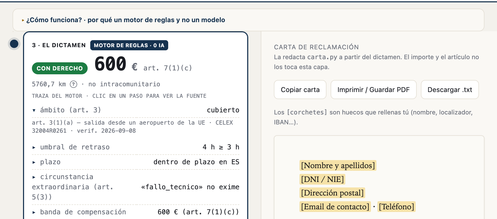

# Demo 6 — Agente de reclamaciones de consumo (EU261)

Aplicación que calcula la compensación EU261 a partir de los datos del vuelo, clasifica la
causa alegada y redacta una reclamación con trazabilidad a las fuentes jurídicas utilizadas.

**El importe y la elegibilidad salen de un motor de reglas determinista, nunca del modelo.**
El LLM solo lee el relato libre del usuario, extrae los hechos del vuelo y elige una categoría
de causa de una lista cerrada; el cálculo del artículo, la banda de distancia y el € final los
decide código, no el modelo.

El modelo solo extrae hechos y clasifica la causa; el motor determinista calcula elegibilidad,
distancia e importe. La implementación no usa RAG, vector store ni grafo de agentes.

## Demostración en vídeo

[](https://www.youtube.com/watch?v=EYiOcmyMsqU)



---

## Índice

- [Cómo funciona](#cómo-funciona)
- [Verificación jurídica](#verificación-jurídica)
- [Ejecutar](#ejecutar)
- [Avisos y límites](#avisos-y-límites)

## Cómo funciona

1. **El relato** (opcional) — el usuario pega texto libre; el modelo rellena el formulario de
   la etapa 2. Si no hay clave de modelo configurada, esta etapa no aparece.
2. **Los hechos del vuelo** — 8 campos (origen, destino, fecha, retraso, causa alegada,
   transportista comunitario si es un vuelo entrante a la UE, oferta de la aerolínea, si hubo
   reruteo). Es *todo* lo que entra al motor.
3. **El dictamen** — motor de reglas, 0 IA: veredicto, importe, traza paso a paso (cada paso
   enlaza a su fuente: artículo del Reglamento o sentencia del TJUE con CELEX), y un careo a
   dos columnas de la excusa de la aerolínea contra lo que dice la jurisprudencia.

El motor aplica: ámbito del art. 3(1) (salida UE con cualquier compañía; entrada desde tercer
país solo con transportista comunitario; Reino Unido fuera), distancia por gran círculo,
bandas de indemnización del art. 7(1), reducción del art. 7(2), el umbral de 3 horas
(*Sturgeon*), y el plazo de reclamación (varía por país). Las excusas típicas de la aerolínea
(meteorología, huelga ATC, riesgo de seguridad) no eximen por defecto: la carga de la prueba es
de la aerolínea, así que el dictamen queda como *provisional* pidiendo acreditación, nunca
como concesión automática.

## Verificación jurídica

Cada regla del motor está cotejada contra fuente primaria: el texto del Reglamento (CE) nº
261/2004 y el fallo de 9 sentencias del TJUE, ambos en EUR-Lex (CELEX citado en cada caso;
ver la tabla artículo por sentencia en `reglas.FUENTES` y `precedentes.py`). Quedan 4 caveats
residuales documentados en el código: atención médica sin holding del TJUE, plazos que remiten
a Derecho nacional, vuelos con conexión no implementados, inciso *in fine* del art. 3(1)(b).

Sobre un dataset de 33 relatos con ground truth escrito a mano: el motor acierta 33/33 contra
ese ground truth (`--sin-llm`); en modo real (extracción por modelo incluida) 33/33 también,
tras afinar el prompt de extracción — ver el detalle y el matiz de qué mide cada número en el
mismo documento.

## Ejecutar

```bash
python3 reglas.py                    # autocheck del motor
python3 test_reglas.py               # tests del motor
python3 test_golden.py               # 30k+ casos congelados: falla si el motor cambia de comportamiento
python3 test_carta.py                # tests de la redacción de la carta
python3 agente.py                    # autocheck del glue (modo inyectado, sin modelo)
python3 eval/generar_dataset.py      # regenera eval/dataset.jsonl (determinista)
python3 eval/run_eval.py --sin-llm   # mide el motor contra el ground truth
python3 agente.py "Madrid-Nueva York, 4h de retraso, problema técnico, me ofrecen 250€"
python3 eval/run_eval.py             # modo real: necesita clave de modelo (ver .env.example)
./correr.sh --ui                     # UI en http://127.0.0.1:8060
```

Sin dependencias fuera de `openai` (cliente de modelo) y la librería estándar. La UI es
`http.server` puro, sin framework ni build. El PDF de la carta sale de Chrome headless, sin
dependencia Python nueva.

## Avisos y límites

- El articulado está verificado contra fuente primaria, con caveats documentados (ver arriba).
  Ninguna salida de este repo es asesoramiento jurídico: es una demo de capacidad técnica.
- El dataset de evaluación es sintético; mide extracción y cálculo contra etiquetas preparadas
  para esta demo.
